# Home-Assistant Extended for Toon

Shows and controls entities from your own Home Assistant on a (rooted) Toon. Your entities appear as
cards, sorted into Home Assistant's areas. You choose which entities, rename them, mark favourites and set
the order of the areas. A web editor makes setup easy when there are many entities.

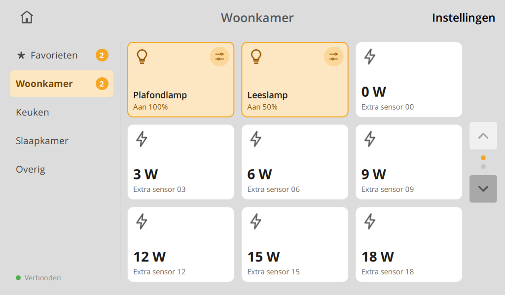

## What you get

- **A main screen with cards.** The areas are tabs on the left: **Favorieten** first, then the areas
  in your order, **Overig** (entities without an area) last. The number next to an area is how many
  lights and switches are on there. On the right are the cards of that area, 9 per page. Swipe or use the
  arrows; the dots show the page.
  - **Temperature and humidity per area** (optional): under an area's name on its tab, e.g. *21,3° · 54%*.
    Choose the sensors under *Instellingen > Ruimtes* (per area a temperature and a humidity sensor, grouped by
    area with the area's own first; a tap again clears it) or in the web editor. Any sensor will do, also one from
    another area. The choice offers sensors with device class `temperature` / `humidity` (or, without a
    device class, a unit °C/°F/K, or % with "humid"/"vocht" in the name).
  - **Tap a card** to switch it (light, switch, fan, cover, lock, valve, group, …), run it (scene, script),
    or press it (button). It lights up in warm yellow when on, and pulses briefly
    until Home Assistant answers. If the command fails, the card goes back and a short notice appears at the bottom.
  - **A lock that unlocks, a garage door or gate that opens** (covers with device class `garage`, `gate` or
    `door`) asks first: "Voordeurslot ontgrendelen?". One stray tap on the Toon or its tile doesn't open the
    house. Locking and closing go at once.
  - **Numbers and choices**: a tap on a `number` / `input_number` opens its screen with - and + in the
    entity's own steps, and as Home Assistant shows it: a slider (mode `slider` or `auto`), or a button to
    type the value on the Toon's keyboard (mode `box`). A `select` / `input_select` shows its options as
    buttons. A **counter** has the same screen: - and + count by the counter's own step, **Reset** puts it
    back to its initial value, and a count can be typed.
  - **Water heaters** (`water_heater`) show their temperature and open the thermostat's screen: the target
    with - and +, and the way of heating (eco, electric, …).
  - **Timers** say "Loopt tot 10:42" or "Pauze · 4:32 over". A tap opens the timer's screen: the time left,
    counting down, and **Start**, **Pauze**, **Afronden** (ends it as if its time was up) and **Annuleren**.
  - A sensor with a time (device class
    `timestamp`) says "10:42", "morgen 07:30" or "14-11 10:42", not the raw text.
  - **Sensors** show their value in large text: "21,4 °C", "350 W".
  - Each type has its own icon: lamp, plug, thermometer, blinds, shield, …
  - A small dot at the bottom left shows the connection ("Verbonden · live" with live updates). Words
    about a problem only appear when something is wrong. Under it, when data last came in from Home
    Assistant ("bijgewerkt 10:42", with the date when it wasn't today); with a live connection that moves on
    with every update Home Assistant sends.
  - **Live**: a change in Home Assistant (a lamp switched with its own switch, a sensor's new value) shows
    on the Toon at once.

| Favourites | A failed command |
|---|---|
| 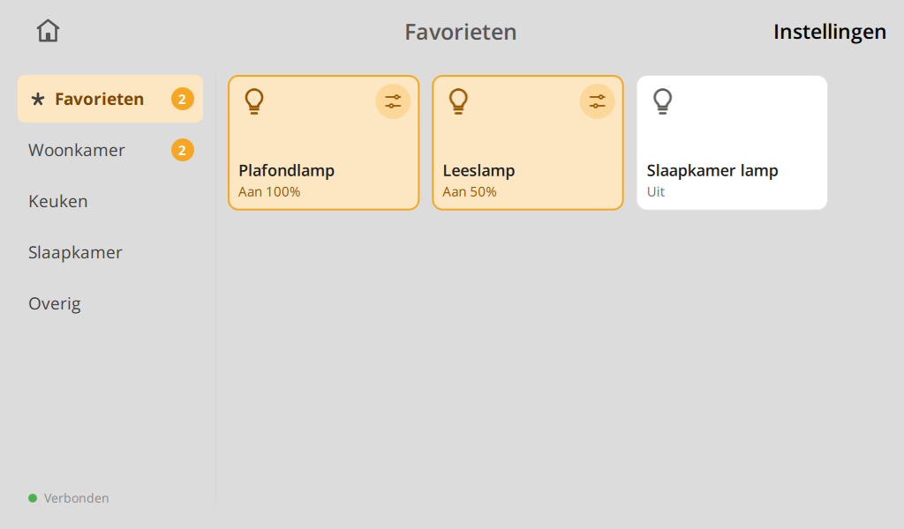 | 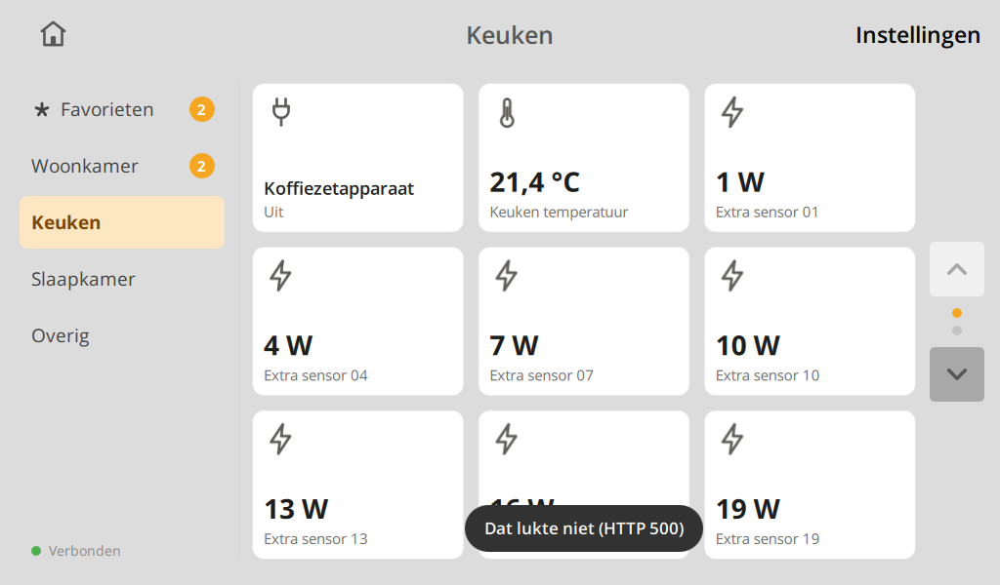 |

- **Lights**: the settings button on a dimmable lamp's card (or holding the card) opens its screen:
  the on/off switch, a **brightness** slider with -/+ (10%), and when the lamp supports them a **colour**
  bar with colour buttons and a **colour temperature** slider (warm to cool, within the lamp's own range).
  The command goes out when you let go of a slider. The card shows the brightness: "Aan 60%".

  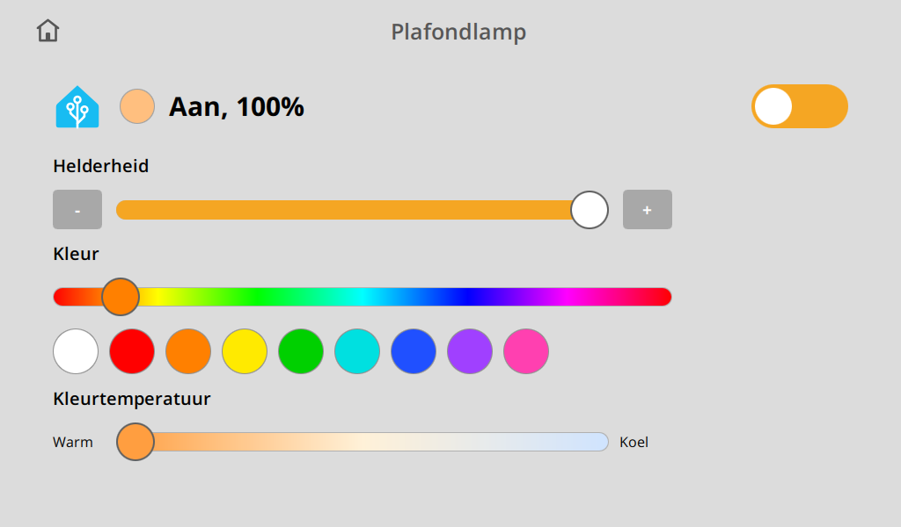

- **Alarm panels** (`alarm_control_panel`) get a **double card**: a shield in the state's colour (green
  off, red on), the state, and buttons right on the card. When it's off, it shows the arm modes the panel
  has (Afwezig, Thuis, Nacht, …, as many as fit). When it's on, it shows *Uitschakelen*.
  - without a code: the buttons work right away;
  - with a code: the alarm screen opens with the mode already chosen; type the code on the keypad
    (numeric codes) or with *Code invoeren* (text codes), then press the mode.

  The code is only sent to Home Assistant and is never saved. If Home Assistant refuses a wrong code,
  you get the message "Geweigerd (verkeerde code?)". Arming only asks for a code when the panel needs one
  for arming (`code_arm_required`). The card pulses red while the alarm is going off.

| Alarm card | Alarm screen with keypad |
|---|---|
|  |  |

- **Thermostats** (`climate`) show the room temperature in large text, with the target and what it does
  ("Naar 20,5° · verwarmt"); the card lights up while heating. A tap opens its screen: the target with
  - and + (sent a moment after your last tap), and buttons for the mode (Uit, Verwarmen, Automatisch, …)
  and the presets (Eco, Comfort, Weg, …). A thermostat with a range (heat_cool) gets a low and a high target.
- **Fans**: the card shows the speed ("Aan 50%") or the preset. A tap opens the fan screen: on/off, the
  speed (slider, and - and + in the fan's own steps), and when the fan has them its presets, oscillation
  (Zwenken) and direction.
- **Humidifiers** work the same way as thermostats: the humidity now on the card; the screen has the target humidity,
  on/off and the modes.
- **Speakers** (`media_player`) get a double card: album art, what plays, and the keys previous,
  play/pause, next and (when there is room) volume - and +. A tap elsewhere on the card opens the speaker
  screen: big keys, a volume slider, mute, power and the source (Radio, Spotify, …).
- **Cameras** get a double card with their still image, renewed with every poll. A tap shows it full
  screen, renewed every 2 seconds. The image comes from Home Assistant's camera proxy. A moving picture
  (an animated GIF, such as a rain radar camera gives) plays, on the card and full screen, and is only
  fetched again when Home Assistant gives a new camera token (about every 5 minutes).
- **Persons** and **device trackers**: Thuis, Weg or the name of the zone, with the photo from Home
  Assistant when there is one. A tap opens a screen with "sinds 14:05", the accuracy, and a **map** with
  the location (zoom with - and +).
- **Weather** gets a double card: the icon, temperature and what it is now, humidity and wind, and the
  forecast for the next days (or hours, when the weather entity has no daily forecast).

| New cards | Thermostat |
|---|---|
| 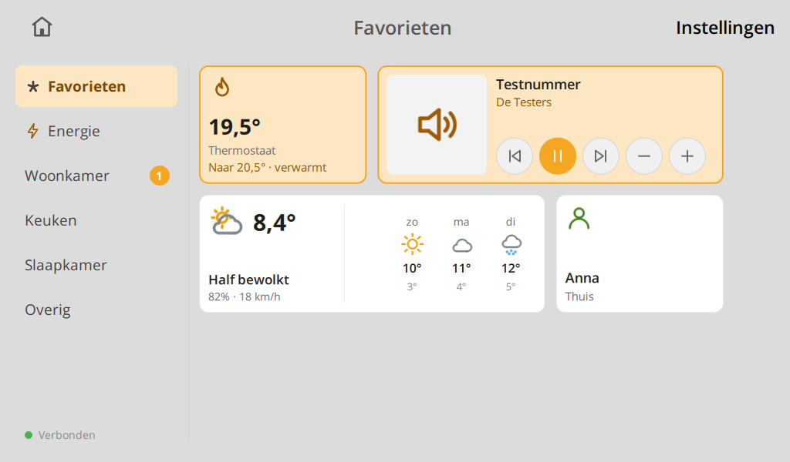 | 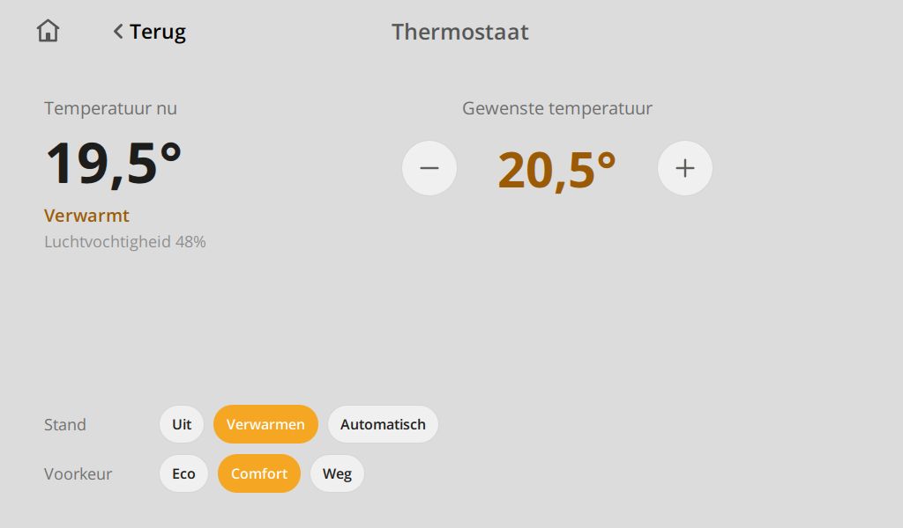 |

| Speaker | Person with map |
|---|---|
| 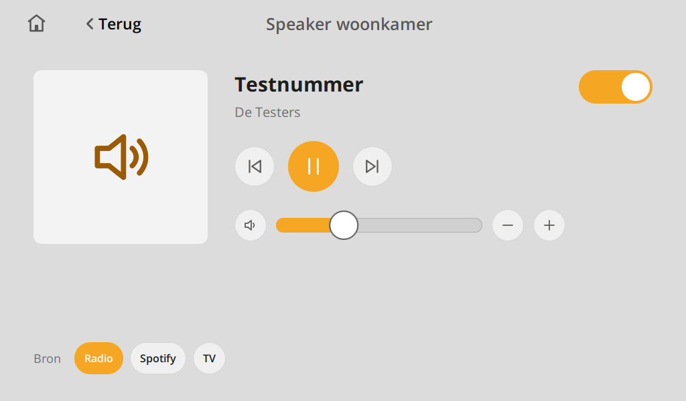 | 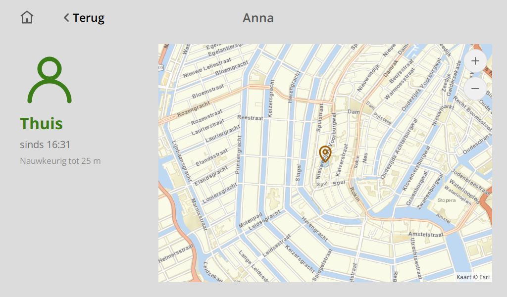 |

- **An Energie tab** (only when you set it up): electricity, solar panels, gas and water. Each panel shows
  today's total, the power now (electricity: also what goes back to the grid), and today per hour as bars
  (electricity sent back below the line). It has its own entities, apart from the cards: *Instellingen >
  Energie* on the Toon, or the Energie section of the web editor. Per part you choose one or more entities;
  more are added up (e.g. the two tariffs of a smart meter, or three phases):

  | Part | Unit | |
  |---|---|---|
  | Stroom: verbruik nu | W, kW | power now (negative = sending back) |
  | Stroom: meterstand verbruik | kWh, Wh | meter reading(s) |
  | Stroom: meterstand teruglevering | kWh, Wh | meter reading(s) |
  | Zonnepanelen: vermogen nu | W, kW | |
  | Zonnepanelen: opgewekt (totaal) | kWh, Wh | |
  | Gas: meterstand | m³ | |
  | Water: meterstand | L, m³ | shown in litres |
  | Stroomprijs (per kWh) | EUR/kWh, ct/kWh, EUR/MWh | fixed, or a dynamic contract's hourly price |
  | Terugleververgoeding (per kWh) | the same | without it: the electricity price |
  | Gasprijs, Waterprijs (per m³) | EUR/m³ | |

  For a meter reading the app works out today's use itself, from Home Assistant's history since yesterday
  midnight: all of it once (at the start, on a new day, after changing these settings), then every 5 minutes only
  the readings since the last time (a meter that reports every few seconds has thousands a day), plus the live
  reading. A meter that resets (a daily utility meter) works too.
  - **Yesterday**: under today's total "gisteren tot nu …" (yesterday up to this time of day, and the whole
    day), and yesterday's hours as light bars behind today's.
  - **Costs**: with a price, today's costs next to the total, worked out per hour (use × that hour's price;
    electricity minus what went back).
  - **Stroomprijs**: a panel with the price now, the cheapest (and dearest) hour still to come, and today's
    price per hour, the current hour dark (a negative price below the line). The hours come from the price
    entity's attributes when it has them (Nordpool `today` / `raw_today`, ENTSO-e `prices_today`, or `prices`),
    else from its history. More price entities are added up (e.g. a price and a surcharge).

| Energie tab | Energie settings on the Toon |
|---|---|
| 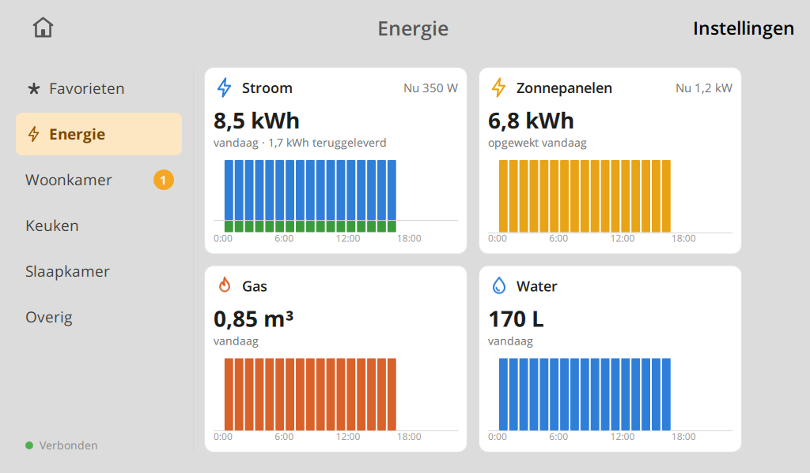 | 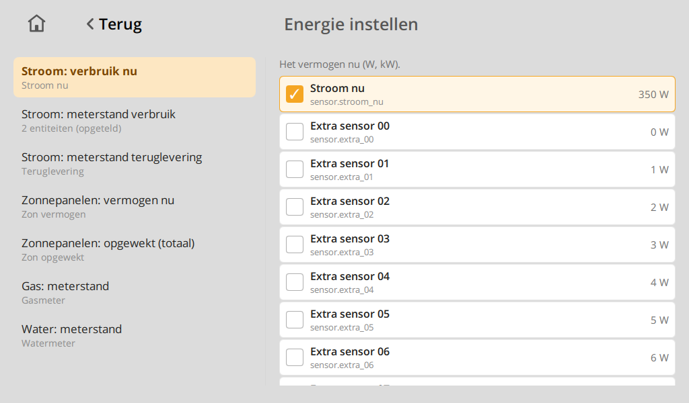 |

- **A tile** with four entities as mini cards (your choice under *Instellingen > Tegel* or in the web
  editor, in your order; nothing chosen: your first four favourites) (icon, name, state; warm yellow when on), in the
  main screen's style. A tap on a mini card does what the card does (switch, run, open its screen); the rest
  of the tile opens the main screen.
- **The Home Assistant icon in the systray** (optional, in *Instellingen* or the web editor). A tap
  opens the main screen. A red dot appears on it when one of your alarm panels goes off.

  

- **A setup screen on the Toon**: address, token, connection test, the systray option, and an entity
  chooser with search, area and type filters, plus rename (pencil) and favourite (star).
  It also shows the web editor's full address with the Toon's IP address, and a **QR code** of it:
  scan it with your phone and paste the token there instead of typing it on the Toon.

| Settings | Choosing entities on the Toon |
|---|---|
| 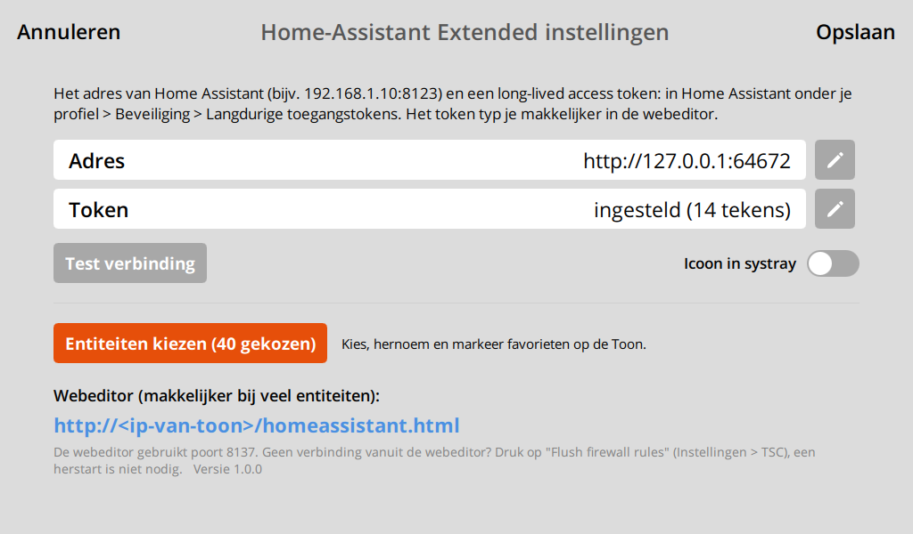 | 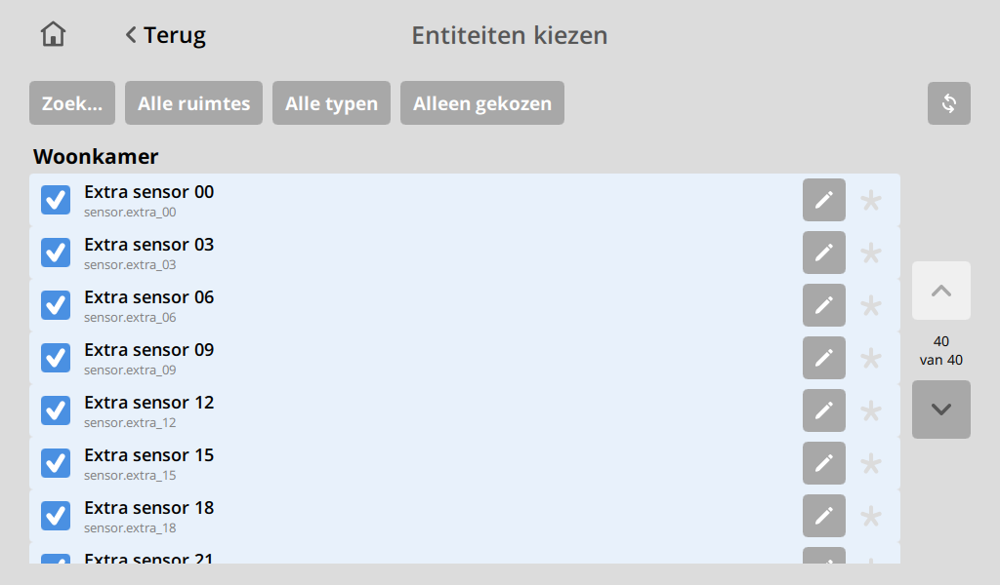 |

- **A web editor** at `http://<toon-ip>/homeassistant.html`.

## Setup

1. In Home Assistant, open your profile, then **Security**, then **Long-lived access tokens**, and create
   a token.
2. On the Toon, add the *Home-Assistant* tile, tap it, then **Instellingen**. Enter the address (e.g.
   `192.168.1.10:8123`; `http://` and port 8123 are added when you leave them out). Typing the token
   on the Toon works, but it is long: the web editor is easier for that.
3. Choose entities on the Toon (**Entiteiten kiezen**) or in the web editor.

Use the IP address of Home Assistant: the Toon usually can't resolve `homeassistant.local`.

## Web editor

The easiest way in: scan the QR code on the Toon's settings screen (*Instellingen* in the app).
The Toon's IP address comes from `/proc/net/fib_trie` (else from a connection the Toon has open).

The page is published to the Toon's own web server (`/qmf/www/homeassistant.html`). It talks to the
app over a WebSocket on **port 8137**. The app adds that port to `/etc/default/iptables.conf`. **On a
real Toon the firewall doesn't pick up the port by itself.** If the web editor can't connect to the Toon,
press **Flush firewall rules** (Instellingen > TSC); a reboot isn't needed. A reboot works too.

On a phone the page has four tabs at the top: **Gekozen** (with the number chosen), **Toevoegen**,
**Energie** and **Verbinding**. It opens on the one you need: Verbinding when Home Assistant isn't set up yet, Toevoegen
when nothing is chosen, otherwise Gekozen. On a computer you see everything side by side.

In the web editor you can:
- set the address and token (the token is write-only: the page never gets it back from the Toon);
- tick entities, or tick all entities of an area at once; filter by search, area and type;
- see your chosen entities grouped per area; rename them, mark favourites and set their order within the
  area (drag them by ⠿, or ▲▼, or sort by name or favourites first): that's the order of the cards on the Toon;
- set the **order of the areas** (drag an area by the ⠿ before its name, or ▲▼; *Overig* too): that's the order of the tabs on
  the Toon. *Ruimtes zoals in Home Assistant* goes back to Home Assistant's order (Overig last);
- choose what the **tile** shows (*Op de tegel*: four lists; nothing chosen = the favourites);
- choose the tab the Toon **opens on** (*Op de Toon openen op*): the last one you used, Favorieten, Energie,
  an area or Overig. On the Toon: *Openen op* on the settings screen (each tap the next choice);
- choose the entities of the **Energie** tab (a list per part, only entities with a fitting unit);
- choose per area the **temperature and humidity** sensors shown on its tab (*Ruimtes*);
- turn the systray icon on or off.

Press **Opslaan op Toon** to save. The Toon updates right away.

**Many entities:** the list of all entities is kept on the Toon and in your browser, so the page stays quick
with hundreds of them. See [Caching](#caching), also for **Cache wissen**.

If port 8137 is already in use, add `"webPort": 8140` (or any free port) to the settings file and restart
the GUI. The app writes the port into the published page.

**Security:** anyone on your network who can reach the Toon can open the web editor and change the
selection or the connection. They can't read the token: the page never gets it, and the app uses the saved
token only for the saved address. Testing or saving another address from the web editor needs the token
typed in again (on the Toon itself another address keeps the token). This is the same trust level as the
Toon's other local pages.

## How it talks to Home Assistant

**Live updates** over Home Assistant's WebSocket API (`ws://<home assistant>/api/websocket`, `wss://` for
https): the app logs in with the token and subscribes to the chosen entities, the Energie tab's and the areas' sensors with
`subscribe_entities` (Home Assistant 2022.4 or newer). Home Assistant then sends every change at once. When the
connection drops, the app polls every `pollSeconds` and connects again (after 2, 4, 8 … seconds, at most a
minute). With an older Home Assistant it only polls. While live, it still polls every 5 minutes (names, areas).
A connection can also die without closing (a computer that sleeps, a router restart): the app sends a `ping`
every 30 seconds; when nothing comes back it polls at once and connects again. A poll that differs from what live
said also counts as a dead connection.

Everything else goes over the REST API, with the token as a `Bearer` header:
- `GET /api/` for the connection test;
- `POST /api/template` to get all entities with their area and Home Assistant's area list (see
  [Caching](#caching) for when). It also fetches the states of the chosen entities in **one small request**
  every 10 seconds when there are no live updates (`pollSeconds` in the settings), with the alarm attributes `code_format`,
  `code_arm_required` and `supported_features`, for lights `brightness`, `supported_color_modes`,
  `hs_color`, `color_temp_kelvin` and its range, and the attributes a thermostat, humidifier, speaker,
  camera, person or weather card needs;
- `POST /api/services/weather/get_forecasts?return_response` for the forecast (every 30 minutes;
  Home Assistant 2024.x or newer);
- `GET /api/history/period/<start>?end_time=<now>&filter_entity_id=…&minimal_response&no_attributes` for the
  Energie tab's meter readings and prices (since yesterday midnight once, then only the new ones every 5 minutes;
  without `end_time` Home Assistant gives only one day from the start);
- `GET /api/camera_proxy/<camera>?token=…` for camera images, and the photos and album art Home Assistant
  gives in `entity_picture` (these carry their own token);
- `POST /api/services/<domain>/<service>` to switch (e.g. `light/turn_on` / `light/turn_off` as the card shows
  it, not `toggle`, `light/turn_on` with
  `brightness_pct`, `hs_color` or `color_temp_kelvin`, `scene/turn_on`,
  `alarm_control_panel/alarm_arm_away` with `code`, `climate/set_temperature`, `climate/set_hvac_mode`,
  `climate/set_preset_mode`, `humidifier/set_humidity`, `media_player/media_play_pause`,
  `media_player/volume_set`, `media_player/select_source`, `fan/set_percentage`, `fan/set_preset_mode`,
  `fan/oscillate`, `fan/set_direction`, `valve/open_valve`, `timer/start` / `pause` / `finish` / `cancel`,
  `number/set_value`, `counter/increment` / `decrement` / `reset` / `set_value`, `select/select_option`, `water_heater/set_temperature`; an old-style `group` has no
  services of its own and goes through `homeassistant/turn_on` / `turn_off`).

With live updates a poll still goes out every 5 minutes (names, areas), and it checks the live connection:
when Home Assistant's `last_updated` of an entity is newer than what live brought, live missed something and
connects again. A sensor that changes every second differs from a poll's answer all the time; by the time
of the state, not its value, that is no reason to connect again.

Ticks, stars and names you change on the Toon show at once; the settings file is written 2 seconds after
the last tap (one write to the Toon's flash for a row of ticks), the states are fetched once after it.

**The map** on the person screen uses Esri's World Street Map tiles. OpenStreetMap's own tile servers
refuse an app like this one (their tile usage policy wants an identifying User-Agent, which a QML image
can't send). For another map, put its tile address in the settings file as `"mapTileUrl"`, with `{z}`,
`{x}` and `{y}`, and restart the GUI.

## Caching

The app keeps a few things so the Toon (a slow computer) and your network don't do the same work again and
again. What it keeps, where, and when it is renewed:

| What | Where | Renewed | Why |
|---|---|---|---|
| The list of **all entities** of Home Assistant (id, name, area, state, unit) and the area list | memory, and the file `/mnt/data/tsc/homeassistantExtended.entities.json` | after 6 hours; when you open *Entiteiten kiezen* or *Energie instellen* with a list older than an hour; with ⟳ in the web editor; with **Cache wissen** | often hundreds of entities: about 50–100 kB, too much to fetch at every start or send at every change |
| The same list in the **web editor** | your browser (`localStorage`) | when the Toon's list has another version (the time it was fetched) | the Toon sends it once instead of with every message |
| The **energy history** (meter readings and prices per hour) | memory | in full at the start, on a new day and after changing the Energie settings; else every 5 minutes only the readings since the last time | a meter that reports every few seconds has thousands of readings a day |
| A **moving camera picture** (an animated GIF, e.g. a rain radar) | memory (its frames) | only when Home Assistant gives a new camera token (about every 5 minutes) | a radar GIF can be a megabyte; a still camera picture is fetched again every poll / every 2 seconds full screen |
| The **weather forecast** | memory | every 30 minutes | it changes slowly |

**Not kept:** the states of your entities. They come live (or from a poll) and are always Home Assistant's
current ones. The token is only kept in the settings file; the web editor never gets it back.

**How the entity list works**
- At a start the app reads the file. When it belongs to the same Home Assistant (the address in it) and is
  younger than 6 hours, Home Assistant isn't asked for the list at all; else it is fetched in the background.
- The app also builds an index (entity id → entry), so a name or an area is looked up at once instead of by
  walking the whole list (that made the chooser slow with many entities).
- The cards don't depend on this list: their names and areas come with the states. The list is for choosing
  (the chooser, the web editor, the energy settings) and as a fallback for a name or area.

**How the web editor's copy works**
- The Toon's state message (which entities you chose, the connection, …) carries `allVersion`: the time the
  list was fetched. It is small (about 3 kB).
- When the browser's copy has another version, the page asks for the list (`{"type": "entities", "version": …}`);
  the Toon sends it, or only `"same": true` when the page already has it. The page keeps it in `localStorage`.

**Cache wissen** (on the Toon: *Instellingen*; in the web editor: under Verbinding) empties the file, the
memory and the browser's copy, and fetches the list again. Use it when a name or an area you changed in Home
Assistant doesn't show in the chooser yet. You don't need it for states: those are never cached.

## Files

| File | What |
|---|---|
| `HomeassistantExtendedApp.qml` | settings, Home Assistant client, polling, the state texts, the commands, web editor server |
| `HaLive.qml` | live updates: Home Assistant's WebSocket API (created inside the app, `app.live`) |
| `HaEnergy.qml` | the Energie tab's history, prices and costs (created inside the app, `app.energyData`) |
| `HomeassistantTile.qml` | the tile: four favourites as mini cards |
| `HomeassistantScreen.qml` | the main screen: area tabs and pages of cards |
| `HaCard.qml` | a card: icon, name, state, tap feedback |
| `HaAlarmCard.qml` | the double card of an alarm panel, with its buttons |
| `HomeassistantSetupScreen.qml` | address, token, test, systray option |
| `HomeassistantEntitiesScreen.qml` | the entity chooser on the Toon |
| `HomeassistantAlarmScreen.qml` | an alarm panel with keypad |
| `HomeassistantLightScreen.qml` | a light: brightness, colour, colour temperature |
| `HomeassistantClimateScreen.qml` | a thermostat, humidifier or water heater: target, mode, presets |
| `HomeassistantInputScreen.qml` | a number (slider or box), a counter or a choice (its options) |
| `HomeassistantTimerScreen.qml` | a timer: the time left, start, pause, finish, cancel |
| `HomeassistantFanScreen.qml` | a fan: speed, presets, oscillation, direction |
| `HomeassistantMediaScreen.qml` | a speaker: keys, volume, power, source |
| `HomeassistantCameraScreen.qml` | a camera, full screen |
| `HomeassistantPersonScreen.qml` | a person or device tracker, with the map |
| `HomeassistantEnergySetupScreen.qml` | the Energie tab's entities, on the Toon |
| `HomeassistantTileSetupScreen.qml` | what the tile shows, on the Toon |
| `HomeassistantAreaSetupScreen.qml` | per area the temperature and humidity sensors, on the Toon |
| `HaMediaCard.qml`, `HaCameraCard.qml`, `HaWeatherCard.qml` | the double cards of a speaker, camera and the weather |
| `HaEnergyView.qml`, `HaBarChart.qml` | the Energie tab and its bars per hour |
| `HaCameraImage.qml` | a camera image that renews without flicker |
| `HaRoundButton.qml` | the round buttons (media keys, - and +) |
| `HaSlider.qml` | the touch slider used on the light screen |
| `HomeassistantTray.qml` | the systray icon |
| `webeditor.html` | the web editor (published to `/qmf/www`) |
| `drawables/ha-logo.svg` | the logo |
| `drawables/icons/` | the icons per type (`<name>.svg`, `-on` when on, `-dim` for the dimmed screen), `weather-<condition>.svg` |
| `screenshots/` | the pictures in this README (from the simulator, Toon 2) |

Settings: `/mnt/data/tsc/homeassistantExtended.userSettings.json` (`url`, `token`, `entities: [{id, name, fav}]`,
`areaOrder` (`""` is Overig), `defaultTab`, `tileEntities`, `energy: {power, usage, export, solarPower, solar, gas, water, priceUsage,
priceExport, priceGas, priceWater}` (lists of entity ids),
`enableSystray`, `pollSeconds`, `webPort`, `mapTileUrl`). The cached list of all entities:
`/mnt/data/tsc/homeassistantExtended.entities.json`.

Written for the Toon's Qt 5.11, so the QML uses only ES5 JavaScript.

## Tests

`python tools\run_tests.py homeassistant` (also with `--size toon1`) runs `tests\test_homeassistant.py`
against a fake Home Assistant: connection test, choosing/renaming/favourites, sorting, switching,
the main screen (tabs, pages, value cards, temperature and humidity per area, tapping a card, the notice after a failed command), the empty
screen, the tile, the systray option, alarm panels (the card and the screen) with and without a code,
light brightness, colour and colour temperature, fans, thermostats and humidifiers, speakers, weather, cameras,
persons with the map, groups, the question before a lock or garage door opens, valves, timers, numbers
(box and slider), choices, water heaters, taps saved together, the Energie tab (today's totals from the history, its settings, the web editor), the
entity list cache, and the live updates (the fake Home Assistant has a WebSocket API too: pushes, a dropped
connection, polling meanwhile, connecting again).
