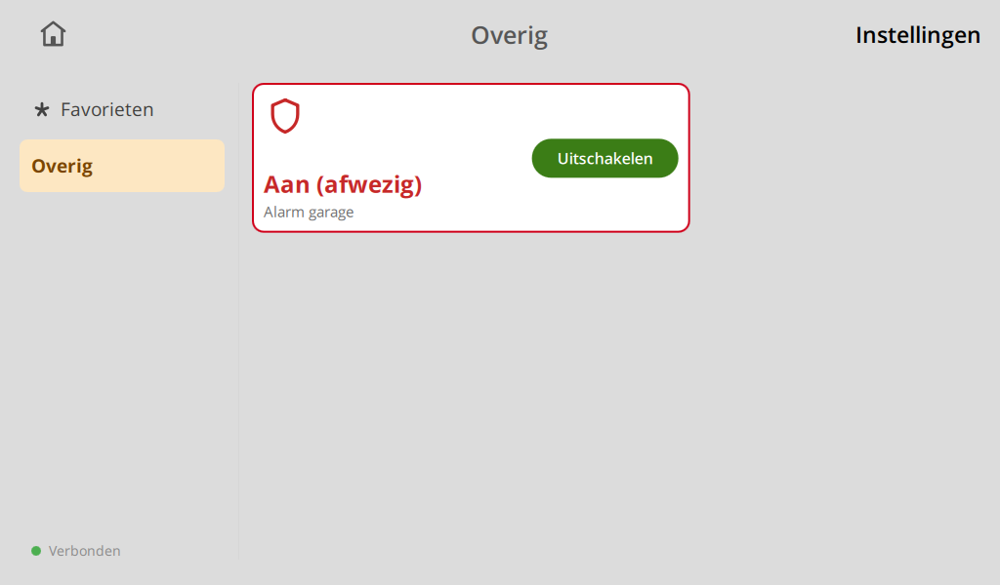
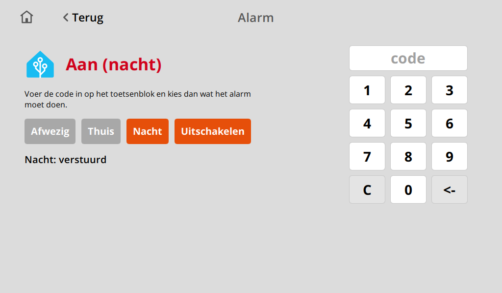
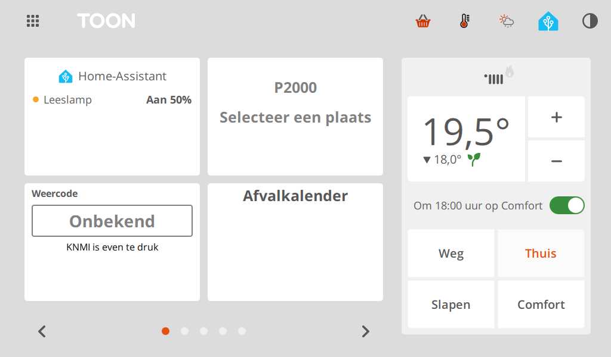

# Home-Assistant Extended for Toon

Shows and controls entities from your own Home Assistant on a (rooted) Toon. Your entities appear as
cards, sorted into Home Assistant's areas. You choose which entities, rename them, mark favourites and set
the order of the areas. A web editor makes setup easy when there are many entities.

## What you get

- **A main screen with cards.** The areas are tabs on the left: **Favorieten** first, then the areas
  in your order, **Overig** (entities without an area) last. The number next to an area is how many
  lights and switches are on there. On the right are the cards of that area, 9 per page. Swipe or use the
  arrows; the dots show the page.
  - **Tap a card** to switch it (light, switch, fan, cover, lock, …), run it (scene, script) or
    press it (button). It lights up in warm yellow when on, and pulses briefly until Home Assistant
    answers. If the command fails, the card goes back and a short notice appears at the bottom.
  - **Sensors** show their value in large text: "21,4 °C", "350 W".
  - Each type has its own icon: lamp, plug, thermometer, blinds, shield, …
  - A small dot at the bottom left shows the connection. Words only appear when something is wrong.

| Favourites | A failed command |
|---|---|
|  |  |

- **Lights**: the settings button on a dimmable lamp's card (or holding the card) opens its screen:
  the on/off switch, a **brightness** slider with -/+ (10%), and when the lamp supports them a **colour**
  bar with colour buttons and a **colour temperature** slider (warm to cool, within the lamp's own range).
  The command goes out when you let go of a slider. The card shows the brightness: "Aan 60%".

  

- **Alarm panels** (`alarm_control_panel`) get a **double card**: a shield in the state's colour (green
  off, red on), the state, and buttons right on the card. When it's off, it shows the arm modes the panel
  has (Afwezig, Thuis, Nacht, …, as many as fit). When it's on, it shows *Uitschakelen*.
  - without a code: the buttons work right away;
  - with a code: the alarm screen opens with the mode already chosen; type the code on the keypad
    (numeric codes) or with *Code invoeren* (text codes), then press the mode.

  The code is only sent to Home Assistant and is never saved. If Home Assistant refuses a wrong code,
  you get the message "Geweigerd (verkeerde code?)". Arming only asks for a code when the panel needs one
  for arming (`code_arm_required`). The card pulses red while the alarm is going off.

| Alarm card | Alarm screen with keypad |
|---|---|
|  |  |

- **A tile** with your favourites, each with its state. Tap a row to switch it; the rest of the tile
  opens the main screen.
- **The Home Assistant icon in the systray** (optional, in *Instellingen* or the web editor). A tap
  opens the main screen. A red dot appears on it when one of your alarm panels goes off.

  

- **A setup screen on the Toon**: address, token, connection test, the systray option, and an entity
  chooser with search, area and type filters, plus rename (pencil) and favourite (star).
  It also shows the web editor's full address with the Toon's IP address, and a **QR code** of it:
  scan it with your phone and paste the token there instead of typing it on the Toon.

| Settings | Choosing entities on the Toon |
|---|---|
|  |  |

- **A web editor** at `http://<toon-ip>/homeassistant.html`.

## Setup

1. In Home Assistant, open your profile, then **Security**, then **Long-lived access tokens**, and create
   a token.
2. On the Toon, add the *Home-Assistant* tile, tap it, then **Instellingen**. Enter the address (e.g.
   `192.168.1.10:8123`; `http://` and port 8123 are added when you leave them out). Typing the token
   on the Toon works, but it is long: the web editor is easier for that.
3. Choose entities on the Toon (**Entiteiten kiezen**) or in the web editor.

Use the IP address of Home Assistant: the Toon usually can't resolve `homeassistant.local`.

## Web editor

The easiest way in: scan the QR code on the Toon's settings screen (*Instellingen* in the app).
The Toon's IP address comes from `/proc/net/fib_trie` (else from a connection the Toon has open).

The page is published to the Toon's own web server (`/qmf/www/homeassistant.html`). It talks to the
app over a WebSocket on **port 8137**. The app adds that port to `/etc/default/iptables.conf`. **On a
real Toon the firewall doesn't pick up the port by itself.** If the web editor can't connect to the Toon,
press **Flush firewall rules** (Instellingen > TSC); a reboot isn't needed. A reboot works too.

On a phone the page has three tabs at the top: **Gekozen** (with the number chosen), **Toevoegen** and
**Verbinding**. It opens on the one you need: Verbinding when Home Assistant isn't set up yet, Toevoegen
when nothing is chosen, otherwise Gekozen. On a computer you see everything side by side.

In the web editor you can:
- set the address and token (the token is write-only: the page never gets it back from the Toon);
- tick entities, or tick all entities of an area at once; filter by search, area and type;
- see your chosen entities grouped per area; rename them, mark favourites and set their order within the
  area (▲▼, or sort by name or favourites first): that's the order of the cards on the Toon;
- set the **order of the areas** (▲▼ next to an area's name): that's the order of the tabs on the Toon.
  *Ruimtes zoals in Home Assistant* goes back to Home Assistant's order;
- turn the systray icon on or off.

Press **Opslaan op Toon** to save. The Toon updates right away.

If port 8137 is already in use, add `"webPort": 8140` (or any free port) to the settings file and restart
the GUI. The app writes the port into the published page.

**Security:** anyone on your network who can reach the Toon can open the web editor and change the
selection or the connection. They can't read the token. This is the same trust level as the Toon's other
local pages.

## How it talks to Home Assistant

Only the REST API, with the token as a `Bearer` header:
- `GET /api/` for the connection test;
- `POST /api/template` to get all entities with their area and Home Assistant's area list (when choosing,
  and every 30 minutes). It also fetches the states of the chosen entities in **one small request**
  every 10 seconds (`pollSeconds` in the settings), with the alarm attributes `code_format`,
  `code_arm_required` and `supported_features`, and for lights `brightness`, `supported_color_modes`,
  `hs_color`, `color_temp_kelvin` and its range;
- `POST /api/services/<domain>/<service>` to switch (e.g. `light/toggle`, `light/turn_on` with
  `brightness_pct`, `hs_color` or `color_temp_kelvin`, `scene/turn_on`,
  `alarm_control_panel/alarm_arm_away` with `code`).

## Files

| File | What |
|---|---|
| `HomeassistantExtendedApp.qml` | settings, Home Assistant client, polling, alarm commands, web editor server |
| `HomeassistantTile.qml` | the tile with favourites |
| `HomeassistantScreen.qml` | the main screen: area tabs and pages of cards |
| `HaCard.qml` | a card: icon, name, state, tap feedback |
| `HaAlarmCard.qml` | the double card of an alarm panel, with its buttons |
| `HomeassistantSetupScreen.qml` | address, token, test, systray option |
| `HomeassistantEntitiesScreen.qml` | the entity chooser on the Toon |
| `HomeassistantAlarmScreen.qml` | an alarm panel with keypad |
| `HomeassistantLightScreen.qml` | a light: brightness, colour, colour temperature |
| `HaSlider.qml` | the touch slider used on the light screen |
| `HomeassistantTray.qml` | the systray icon |
| `webeditor.html` | the web editor (published to `/qmf/www`) |
| `drawables/ha-logo.svg` | the logo |
| `drawables/icons/` | the icons per type (`<name>.svg`, `-on` when on, `-dim` for the dimmed screen) |
| `screenshots/` | the pictures in this README (from the simulator, Toon 2) |

Settings: `/mnt/data/tsc/homeassistantExtended.userSettings.json` (`url`, `token`, `entities: [{id, name, fav}]`,
`areaOrder`, `enableSystray`, `pollSeconds`, `webPort`).

Written for the Toon's Qt 5.11, so the QML uses only ES5 JavaScript.

## Tests

`python tools\run_tests.py homeassistant` (also with `--size toon1`) runs `tests\test_homeassistant.py`
against a fake Home Assistant: connection test, choosing/renaming/favourites, sorting, switching,
the main screen (tabs, pages, value cards, tapping a card, the notice after a failed command), the empty
screen, the tile, the systray option, alarm panels (the card and the screen) with and without a code, and
light brightness, colour and colour temperature.
